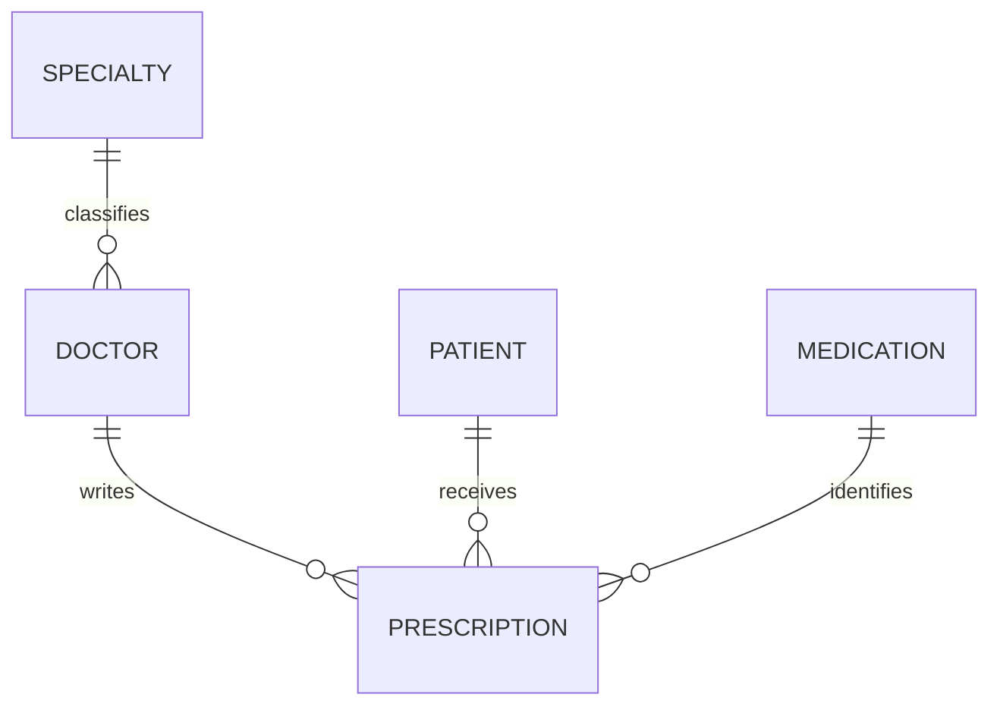

# Data dictionary

One prescription row is one fictional prescription record, not a pharmacy fill, encounter or clinical outcome.

| Table | Grain / key | Fields |
|---|---|---|
| Specialty | One specialty / SpecialtyID | SpecialtyName |
| Doctor | One doctor / DoctorID | DoctorFirstName, DoctorLastName, Specialty (FK) |
| Patient | One patient / PatientID | PatientFN, PatientLN, PatientWeightLb, Address, City, State, ZipCode, Phone (nullable) |
| Medication | One medication / MedicationID | MedicationName, Dosage |
| Prescription | One prescription / PrescID | Patient (FK), Doctor (FK), PrescDate, Medication (FK), PrescQty |

PatientWeightLb is numeric pounds, converted from the original strings ending in `lb`. Phone and ZIP remain text. PrescQty is a positive whole number; the source does not define a common unit across medications. Summing these quantities is an arithmetic reconciliation check, not a measure of comparable treatment volume. Dosage values in the added reference records are explicitly not clinical dosages.

## Relationships

